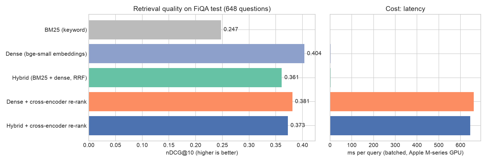

# Finance Q&A Search for RAG: Benchmarking 5 Retrieval Pipelines

The "R" in RAG decides answer quality: if the right passage is not retrieved, the LLM cannot answer correctly. This project builds and **measures** five retrieval pipelines on a real finance Q&A benchmark, then ships the winner in a small search app with optional cited LLM answers.

    



## Data

[FiQA-2018](https://sites.google.com/view/fiqa/) (BEIR version): **57,638 answers** from a personal-finance community and **648 test questions** with human-labelled correct answers. Labelled answers mean retrieval quality can be measured, not guessed.

## Results (648 test questions)

| Pipeline | nDCG@10 | MRR@10 | Recall@10 | Recall@100 | ms / query |
|---|---|---|---|---|---|
| BM25 keyword search (own sparse-matrix implementation) | 0.247 | 0.299 | 0.316 | 0.549 | 0.7 |
| **Dense: bge-small embeddings** | **0.403** | **0.488** | **0.464** | **0.696** | 2.3 |
| Hybrid: BM25 + dense with Reciprocal Rank Fusion | 0.361 | 0.427 | 0.438 | 0.690 | 3.0 |
| Dense + cross-encoder re-rank (top 50) | 0.381 | 0.452 | 0.455 | 0.696 | 661 |
| Hybrid + cross-encoder re-rank (top 50) | 0.373 | 0.444 | 0.449 | 0.690 | 645 |

**Key findings**

1. **Semantic search beats keyword search by 63%** (nDCG@10 0.403 vs 0.247). Dense retrieval was better on 316 questions, BM25 on only 88. Finance questions are often phrased differently from the answers ("rainy-day fund" vs "emergency savings").
2. **"Best practice" add-ons made results worse here.** Hybrid search and re-ranking are often recommended by default, but on this data:
   - fusing in BM25 pulled weak keyword matches into the top 10 (-0.04 nDCG);
   - the re-ranker was trained on web search (MS MARCO), not finance forums, and is **280x slower** for lower quality.
3. **Decision:** the app uses dense retrieval only. The other pipelines stay in the code so they can be re-tested on new data. Lesson: **measure on your own data before adding complexity.**

BM25 settings (k1 = 0.9, b = 0.75) were tuned on the separate dev split; all numbers above are from the test split.

## How it works

```
question ──► embed with bge-small ──► cosine search over 57k cached document vectors ──► top-k passages
                                                                                          │
                                                optional: LLM answers ONLY from these     ▼
                                                passages, citing [1], [2] ...       cited answer
```

- [`src/retrievers.py`](src/retrievers.py) - BM25 written from scratch with SciPy sparse matrices (one matrix product scores all 57k documents), dense retriever with an embedding cache, Reciprocal Rank Fusion, cross-encoder re-ranker.
- [`src/metrics.py`](src/metrics.py) - nDCG@10, MRR@10, Recall@k (BEIR definitions), unit-tested.
- [`src/evaluate.py`](src/evaluate.py) - tunes BM25 on dev, benchmarks all 5 pipelines on test, records latency.
- [`src/rag.py`](src/rag.py) - retrieval + grounded prompt. The LLM is told to use only the numbered sources, cite them, and say when the answer is not there. Works with any OpenAI-compatible endpoint, including a free local model through Ollama.
- [`app.py`](app.py) - Streamlit search app.

## How to run

```bash
python -m venv .venv && source .venv/bin/activate
pip install -r requirements.txt
python -m src.evaluate     # downloads FiQA, embeds the corpus once (~10 min on a laptop), runs the benchmark
pytest -q                  # 5 tests
streamlit run app.py
```

Optional LLM answers (example with a free local model):

```bash
ollama pull llama3.1
export LLM_BASE_URL=http://localhost:11434/v1 LLM_MODEL=llama3.1
streamlit run app.py
```

> The benchmark measures retrieval only. The answer-generation step is included as working code but its answer quality is not benchmarked in this project.

## Next steps

- Fine-tune the embedding model or the re-ranker on FiQA training questions (14k labelled pairs are available).
- Evaluate generated answers for faithfulness to the sources (e.g. with an LLM judge plus human spot checks).
- Move the vector search to FAISS or a vector database for millions of documents.

## Project structure

```
├── app.py                 # Streamlit search app
├── src/data.py            # download and load FiQA
├── src/retrievers.py      # BM25, dense, RRF, re-ranker
├── src/metrics.py         # IR metrics
├── src/evaluate.py        # benchmark
├── src/rag.py             # grounded answering with citations
├── tests/                 # unit tests
└── reports/               # metrics.json, figures
```
